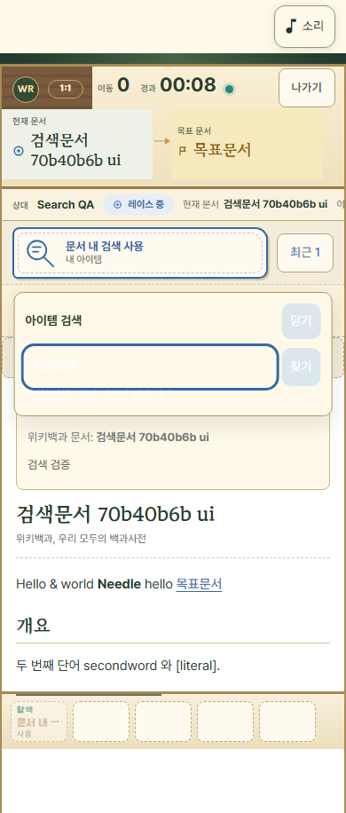
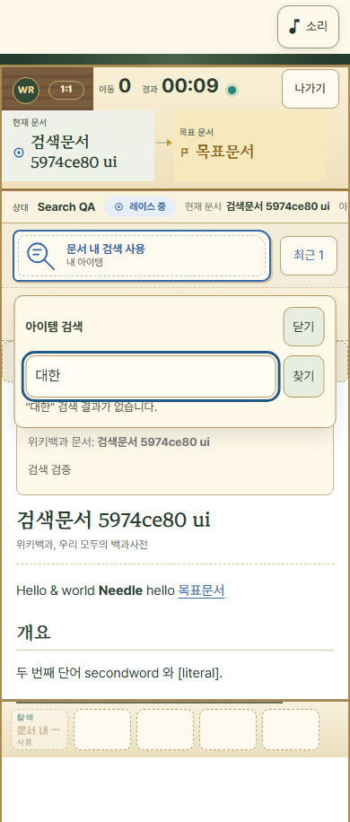
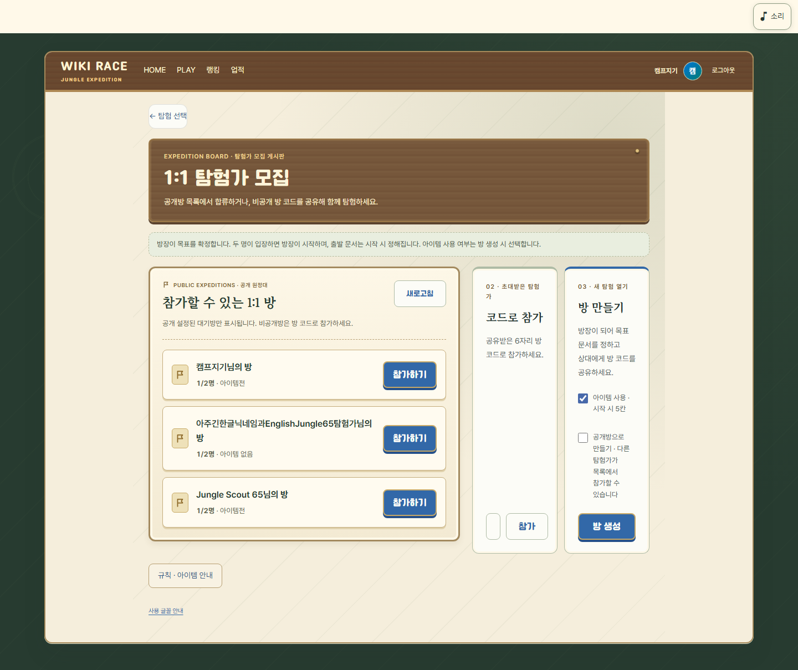
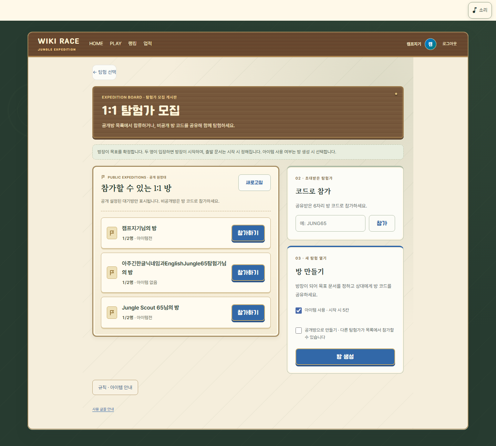

# Jungle65 UI hotfix — Issues #10 / #11

2026-11-03 KST. 제품 기준 **`3b0615b50a9112ca7518c22ea6bbfdb89783667b`**, Production base **`90b3fa49f4313d4ef973c5911824b9c50b041707`**, branch **`codex/jungle65-ui-hotfix-20261103`**. 소스 fingerprint `32e174a680dcc09419a02098b4de0ac7bb6698453a20ed2cce065d48174a6e7a`. 모든 수치는 이 제품과 같은 소스의 미커밋 작업 트리에서 실제 실행한 결과다. 최종 문서 head의 CI/Preview는 PR 최신 SHA로 별도 재확인한다.

**로컬 검증 통과 / Production 재배포 별도 승인 대기.** 운영 DB/migration/Edge/진입 제한/QA 명단·TTL/게임·XP 변경 0. 기존 test0/test1의 인증정보를 요구하지 않았다. 현재 Production은 이 hotfix를 아직 포함하지 않는다. HOME 배너 Issue #9와 후속 기능 변경 0.

## 실제 재현과 원인

**P0.** Production 90b3fa4 원문으로 실제 격리 Auth/DB/Deno Edge/React를 실행했다. `input.value=대한`, focus=true, disabled=false/readOnly=false, `elementFromPoint`가 input 자체이며 찾기 버튼 disabled=false였다. 서버 요청에도 React가 가진 query가 도착했다. 이때 절대 만료까지 13,776ms가 남아 있었다. 즉 입력·포커스·오버레이·만료 문제가 아니라 밝은 양피지(#fff9e9)에 흰 글자/caret(#fff)가 그려지는 충돌이다. placeholder와 message도 흰 계열이었다. Production 사용자 탭은 읽기만 했고 검색 아이템을 추가 사용하지 않았다.

실제 Chromium CDP IME composition 중 Enter가 기존 코드에서 검색 요청1건을 보낸 것도 확인했다. 수정 후 같은 조합 중 요청0건, 조합 확정 뒤 정상 Enter1건이며 미발견은 미소비였다. Windows OS IME 자체의 수동 검증과 구분되는 실제 Chromium 입력 조합 검증이다.

**P1.** 실제 Production Chrome 로비 computed style에서 약320px 오른쪽 패널이 grid 154px+154px로 나뉘고 코드 input은27px이었다. `App-BFPdxYZf.css`의 Jungle65 column 규칙 뒤에 `appStyles-BvfYTh8n.css`의 기존 2열 grid 규칙이 같은 specificity로 로드된다. 개발 서버에서는 반대 순서여서 기존 dev 검사만으로 놓칠 수 있었다. 수정 전 소스를 실제 Vite 배포 번들로 만들어 같은 좁은 카드와 입력칸을 PNG로 재현했다.

## 최소 제품 변경

| 파일 | 변경 이유 |
| --- | --- |
| `css/jungle65Expedition.css` | Jungle65 검색 input/caret/placeholder/message/button의 색과 focus/busy 가독성을 양피지 테마에 맞춤. 글자/caret11.42:1·placeholder5.11:1·안내7.75:1·버튼9.73:1 대비, input/buttons44px 이상 |
| `css/jungle65Lobby.css` | Jungle65 패널 selector가 기존 규칙보다 확실히 우선하도록 변경. 공개방/오른쪽 열은1.6:1에 오른쪽 최소320px. 데스크톱 오른쪽은 세로, 768px은 충분한 전체 폭에서2열, 320/390px은 공개방→코드→생성 세로 |
| `components/WikiViewer.jsx` | Enter 조건 한 줄: 조합 중 `nativeEvent.isComposing` 또는 legacy229이면 검색하지 않음. 조합 확정 후 Enter와 버튼은 기존 handler 사용 |

서버 승인·소유권·문서 hash/manifest·실제 강조·첫 성공1회·미발견 미소비·15초·슬롯/쿨타임·request ID 재시도/F5는 변경하지 않았다. `handleGameSearch`, API/service, 페이지 생성·참가/공개방 privacy/모드 잠금 로직, Supabase 전체와 public 에셋/폰트는 원문 그대로다. 새 의존성 없음.

## 테스트 — 2026-11-03 KST

| 검사 | 결과 |
| --- | --- |
| npm test | **765/765, 실패/skip0**, 기존 Jungle65 보호 포함 |
| npm run build / git diff --check | PASS / PASS; 기존500kB 번들 경고만 존재 |
| 실제 격리 Auth/DB/Edge/React 검색 | **23/23**: 320/390/1440 대비와 value/focus, Chromium 한글 IME/Enter/버튼, canonical 노드 일치,8동시 요청1성공, 미발견 미소비, 동일ID 재시도, 추가 성공/상태 변조 거부,15초/응답 유실/F5,429·timeout·identity 오류, 검색 kill/recovery |
| 실제 두 계정 게임/그룹 회귀 | **23/23**: 정상 생성/참가/시작, 승패·XP·중복 방지·기권·F5, 실제 teleport, 그룹 READY/관전/결과/XP, 모바일 |
| 실제 배포 번들 로비/디자인 | **321검사/42화면 PASS**, 320/390/768/1024/1440/1920px, 실제 폰트 역할·닉네임/숫자·focus·모바일 키보드 높이·기본 비공개·모드 잠금·생성/참가/중복 guard |
| 기존 개발 서버 로비/디자인 | **321검사/42화면 PASS**, 기존 font/CSS 실패 시 fallback 검사 포함 |
| HOME/PLAY/랜딩 보호 | 배포 번들과 개발 서버 각각 수정 전과 **15화면 PNG 정확 동일**, 기존검사 삭제/skip/허용오차 확대0 |

| viewport | 공개방 폭 | 코드 카드 폭 | 생성 카드 폭 | 배치 |
| --- | --- | --- | --- | --- |
| 320 | 256 | 256 | 256 | 코드→생성 세로 |
| 390 | 326 | 326 | 326 | 코드→생성 세로 |
| 768 | 660 | 322 | 322 | 공개방 아래 넓은 2열 |
| 1024 | 542.77 | 339.23 | 339.23 | 코드→생성 세로 |
| 1440 | 542.77 | 339.23 | 339.23 | 코드→생성 세로 |
| 1920 | 542.77 | 339.23 | 339.23 | 코드→생성 세로 |

6자리 실제 value `ABC123`의 표시 공간, 카드 제목/설명/checkbox/button/input의 scroll/client 크기 및 가로 overflow를 각각 검사했다. 320px에서 카드는256px의 사용 가능한 열 전체를 쓰며 글자·컨트롤이 잘리지 않는다. 임의의 고정 카드 최소폭 대신 실제 사용 가능한 열과 내용 잘림을 검사한다.

초기 새 테스트의 잘못된 그룹 접근성 이름과 모바일 gutter 가정은 바로잡았고 실패 로그를 로컬에 보존했다. 새 bundled 검사의 font 실패 주입이 CSS import까지 막아 Vite가 mount하지 못한 경우도 별도 기록했다. 원래 dev font/CSS outage 검사는 그대로 실행하며 bundled 추가 검사에서는 font binary 실패를 주입했다. 이 hotfix가 Production의 임의 CSS 배달 실패까지 복구한다고 주장하지 않는다.

## 전후 PNG

실제 로컬 Auth/DB/Edge/React 검색390px. 테스트 전용 문서/계정이다.

| 수정 전 | 수정 후 |
| --- | --- |
|  |  |

동일 Production 원문→hotfix의 실제 Vite 번들 로비1440px. 공개방/Auth/RPC는 격리된 UI fixture다.

| 수정 전 | 수정 후 |
| --- | --- |
|  |  |

## 재실행과 운영 승인

`scripts/verify-duel-search-local.mjs`에 실제 대비/IME 검사를 추가하고, `scripts/jungle65-entry-smoke.mjs`에 실제 bundle 모드/1920px/카드와6자리 검사를 추가했다. 기존 검사는 유지했다. 테스트 key/session은 메모리에서만 사용하며 실제 격리 API127.0.0.1:55421과 고정 container를 확인한다. 연계 로컬 스택이 필요하다.

```powershell
npm test
npm run build
git diff --check
node scripts/verify-duel-search-local.mjs
node scripts/verify-jungle65-gameplay-local.mjs
$env:JUNGLE65_ENTRY_TASK='.temp/ui-hotfix-20261103/bundled-entry'
$env:JUNGLE65_ENTRY_SOURCE_ROOT='.temp/ui-hotfix-20261103/preserved'
node scripts/jungle65-entry-smoke.mjs --bundled
```

before source root는90b3fa4의 보존된 CSS2개/JSX1개이며, 전후 hash 비교를 재실행하려면 먼저 해당 원문으로 `--before --bundled`를 실행한다. 테스트 산출물의 기존 fixture 날짜와 실제 실행일을 혼동하지 않도록 이 보고서의2026-11-03 실행일·제품 SHA/fingerprint를 기준으로 삼는다.

필요한 다음 승인은 **이 hotfix PR의 main 병합 및 Vercel 자동 Production 재배포1회**다. DB/Edge/일반 사용자 진입 해제 승인을 포함하지 않는다. Production 재배포 후 test0/test1 실제 사용자 QA가 필요하며 허용 시간이 만료됐다면 정확한 두 auth.uid의 제한된 TTL 갱신은 별도 관리자 승인 절차를 따른다. 임의 갱신이나 전역 entry_open 변경0. QA 통과 후 일반 사용자 입장 해제도 별도 승인이다.

트랙 worktree는 AGENTS.md §7 예외에 따라 `docs/agent/CURRENT.md`를 변경하지 않는다. 기존 CURRENT의 배포 전 HOLD 기록과 달리 실제 기준 main은90b3fa4이며 직전 통합 worktree의 운영 배포 기록을 보존했다. 통합/배포 세션에 이 보고서와 최종 hotfix SHA를 인계한다. 기존 루트/통합/보안 worktree·사용자 미커밋 문서·디자인 에셋은 보존했다.
